<picture>
  <source media="(prefers-color-scheme: dark)" srcset="assets/monitor-dark.svg">
  
</picture>

### Hi, I'm Roha Fatima

Full-stack developer · Computer Science @ UT Dallas

I build web apps end to end, from React front ends to Python and Java back ends.

<a href="https://www.learnmips.com">learnmips.com</a> ·
<a href="https://github.com/Roro141/CS_Portfolio">portfolio</a> ·
<a href="https://github.com/Roro141?tab=repositories">all repos</a>

  

 

<code>$ ls projects/</code>

 

| project | what it is | built with |
|---|---|---|
| [**learnmips.com**](https://www.learnmips.com) | Gamified platform for learning MIPS assembly: an in-browser editor with live register and memory views, guided tutorials, puzzles, and binary/hex math practice | Next.js · React |
| [**Portfolio**](https://github.com/Roro141/CS_Portfolio) | My personal portfolio site | JavaScript · HTML · CSS |

<code>$ cat how_the_monitor_works.txt</code>

 

The computer at the top is drawn by a small 3D software renderer I wrote in Python ([`scripts/render.py`](scripts/render.py)). It samples box geometry into surface points, rotates and perspective-projects them onto a character grid, depth-buffers, backface-culls, and shades each point with an ASCII luminance ramp. The screen text is mapped onto the monitor face cell by cell. The 108 frames are packed into one SVG and animated with CSS, since GitHub doesn't run JavaScript.

A GitHub Action re-renders it every day, pulling my most recently pushed repo into the "currently building" line.

